<h1 align="center">Hi 👋, I'm Nguyễn Xuân Tự (Lucas)</h1>

 

  

  
  
  

---

## 🧠 About Me

- 🤖 **AI Engineer** at **Data Impact** (Hanoi), full-time since Sep 2026 after a 5-month internship. I build computer vision, robotics, and anomaly detection systems for manufacturing clients in Thailand and Japan.
- 🎓 Final-year MIS student at **Hanoi University of Science and Technology (HUST)**.
- 🔬 Member of **ML Scientific Working Group (SAMI-HUST)**, co-authoring research on fish freshness classification (**90.97%** accuracy on the FFE dataset, above the previous 85.99% benchmark).
- 📈 Former **Data Scientist Intern** at Institute of Energy Technology (HUST), working on time-series forecasting and anomaly detection for a solar power plant.
- 🌏 **Ex-TEEP Intern** at Asia University & Student Researcher at **XiangQi Technology, Inc.** (Taiwan).
- 🏆 Awarded **Special Performance Award** for 2024 TEEP Program.
- 💬 TOEIC: **930** | Fluent in English & Chinese.
- 🌱 Interested in Vision-Language-Action models, model interpretability, and deploying AI systems with **MLOps** (Docker, FastAPI, Databricks, Vertex AI).

## 🚀 My Featured Projects

_Projects in agentic AI, robotics, computer vision and applied ML, grouped by area._

#### 🧠 Agentic AI & Context

| Repository | Description | Topics |
|---|---|---|
| [**harness-audit**](https://github.com/xuan-tu-ai/harness-audit) | Checks whether a change to an agent harness really made the agent better, with a verdict on each of the four claims a reported improvement rests on. | `agent-evaluation` `llm-agents` `statistics` `python` |
| [**carrycode**](https://github.com/xuan-tu-ai/carrycode) | Open implementation of *Pack Light, CarryOn* ([arXiv:2610.18784](https://arxiv.org/abs/2610.18784)), wrapped as a coding agent you run in your own repository. Old history is replaced by a compact, structured checkpoint of the agent's progress; recent steps stay verbatim. Built on mini-swe-agent, with a SWE-bench Verified evaluation harness. **Experimental.** | `coding-agent` `context-management` `llm-agents` `python` |
| [**dsh-carryon**](https://github.com/xuan-tu-ai/dsh-carryon) | TypeScript port of carrycode's CarryOn runtime as a compaction plugin for DeepSeek Harness: long sessions are folded into validated, versioned records instead of a free-text summary, plus a CarryOn mode in the Web UI. **0.1.0 waits on a real-model release gate.** | `dsh-plugin` `context-management` `typescript` |

#### 🦾 Physical AI & Robotics

| Repository | Description | Topics |
|---|---|---|
| **Vision-Language-Action Robot Arm** 🔒 | Company project at Data Impact: **SmolVLA** with **LeRobot** on an SO-ARM-101 arm, gRPC client-server inference on an RTX 4060 Ti, and a pouring policy trained for 200k steps. Includes a mechanistic interpretability toolkit (cross-attention maps, SigLIP feature maps, weight-diff, FFN neuron probing) and a **YOLOv11** safety module that freezes the robot when a person enters the frame. *Code is private.* | `vla` `lerobot` `interpretability` `pytorch` |
| [**flora-so101-demo**](https://github.com/xuan-tu-ai/flora-so101-demo) | Streamlit demo that plays an SO-101 beer-pouring episode from the global and wrist cameras in sync with task instructions written by nvidia/Flora-Captioner. | `robotics` `video-captioning` `streamlit` |

#### 👁️ Computer Vision & Applied ML

| Repository | Description | Topics |
|---|---|---|
| [**fish-freshness-classification-app**](https://github.com/xuan-tu-ai/fish-freshness-classification-app) | FreshScan AI: fish freshness from eye photos with a Swin-Tiny backbone and dual (average + max) pooling, served by FastAPI on Hugging Face Spaces with a Next.js frontend. Part of the SAMI-HUST research on the FFE dataset. Earlier Streamlit demo: [fish-freshness-classification-web](https://github.com/xuan-tu-ai/fish-freshness-classification-web). | `computer-vision` `swin-transformer` `fastapi` `nextjs` |
| [**Fish_Freshness_ML**](https://github.com/xuan-tu-ai/Fish_Freshness_ML) | Classical-ML pipeline on deep image features for the same task: LightGBM feature selection, then a grid-searched Extra Trees classifier with saved reports and confusion matrices. | `scikit-learn` `lightgbm` `feature-selection` |
| [**aoi-defect-classification-model**](https://github.com/xuan-tu-ai/aoi-defect-classification-model) | EfficientNet (PyTorch) pipeline for automated optical inspection (AOI) defect classification on the AIdea AOI dataset, as a Colab notebook. | `defect-detection` `efficientnet` `pytorch` |

#### 🛠️ Developer Tools & MLOps

| Repository | Description | Topics |
|---|---|---|
| [**kgrun**](https://github.com/xuan-tu-ai/kgrun) | CLI that runs a local Python script on free Kaggle GPUs (2× T4) with one command, through the official Kaggle API. | `mlops` `kaggle` `gpu` `cli` `python` |

---
### 🧠 My Core Expertise & Technical Skills

My skill set is centered around the AI/ML ecosystem, with a strong supporting foundation in web technologies and a focus on efficient tooling.

- **🤖 AI, Machine Learning & Data Science:**
  

    
  

- **🌐 Web Development & Deployment:**
  

    
  

  
- **🛢️ Languages, Databases & Tools:**
  

    
  

  
## 📊 GitHub Stats

  <picture>
    <source media="(prefers-color-scheme: dark)" srcset="https://github-stats-extended.vercel.app/api?username=xuan-tu-ai&show_icons=true&theme=tokyonight&hide_border=true&include_all_commits=true" />
    <source media="(prefers-color-scheme: light)" srcset="https://github-stats-extended.vercel.app/api?username=xuan-tu-ai&show_icons=true&theme=default&include_all_commits=true" />
    
  </picture>
  <picture>
    <source media="(prefers-color-scheme: dark)" srcset="https://streak-stats.demolab.com/?user=xuan-tu-ai&theme=tokyonight&hide_border=true" />
    <source media="(prefers-color-scheme: light)" srcset="https://streak-stats.demolab.com/?user=xuan-tu-ai&theme=default" />
    
  </picture>

  <picture>
    <source media="(prefers-color-scheme: dark)" srcset="https://github-stats-extended.vercel.app/api/top-langs/?username=xuan-tu-ai&layout=compact&theme=tokyonight&hide_border=true&hide=css,html,shell,dockerfile" />
    <source media="(prefers-color-scheme: light)" srcset="https://github-stats-extended.vercel.app/api/top-langs/?username=xuan-tu-ai&layout=compact&theme=default&hide=css,html,shell,dockerfile" />
    
  </picture>

  <picture>
    <source media="(prefers-color-scheme: dark)" srcset="https://raw.githubusercontent.com/xuan-tu-ai/xuan-tu-ai/output/contribution-grid-dark.svg" />
    <source media="(prefers-color-scheme: light)" srcset="https://raw.githubusercontent.com/xuan-tu-ai/xuan-tu-ai/output/contribution-grid.svg" />
    
  </picture>

---

  

